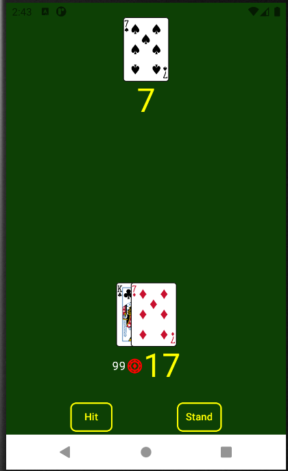
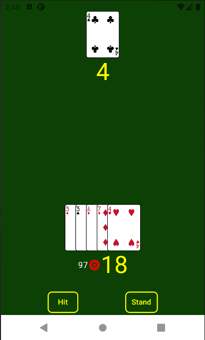
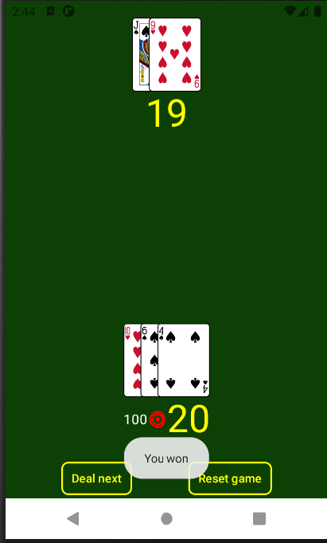

# CardGame
Simple Black Jack for one player

Note:
- Chips in the game are not associated with real money. This game is not gambling; it is for entertainment only.

Black Jack built with Kotlin and Jetpack Compose.

## Screenshots

## Features
- Black Jack engine
- AI opponent
- Responsive Compose UI
- Playing card deck with SVG assets

## Architecture
- Kotlin
- MVVM
- Android ViewModel
- StateFlow
- Jetpack Compose
- Material 3
- Repository pattern

## Project Structure
Third-Party Assets

This project contains third-party playing card artwork distributed under their respective licenses.

See THIRD_PARTY_NOTICES.md for attribution and licensing information.

License

MIT License
